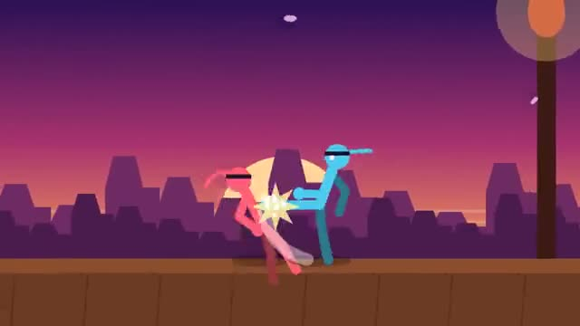

# Stick Duel

Punch, kick, block. First to three rounds wins. A multiplayer starter game from [Multiplayer Agent](https://multiplayeragent.com): 2D, versus, 2 players, with a bot that takes the empty side.

## How it plays

One on one on a rooftop dojo. Punch is fast, kick hits harder and farther, and holding block soaks up most of a hit. Land punch, punch, kick for a combo that knocks them flat. Win three rounds to take the match; the winner stays on.

**Controls:** Arrow keys with Z, X and C, or on-screen buttons.

## Make it yours in the Game Builder

Open the [Game Builder](https://multiplayeragent.com), choose **Start from a starter game** and pick Stick Duel. It opens as version 1 in your studio, ready to play and publish. Then ask for changes, for example:

- Add a special move that charges up as you take hits
- Make the fighters ninjas with swords
- Add a ring-out edge to the rooftop

## Run it yourself

1. Get a free publishable key (`pk_…`) at [multiplayeragent.com](https://multiplayeragent.com).
2. In `index.html`, put it in place of `pk_REPLACE_ME` in the `MP_CONNECT` block.
3. Open `index.html` in a browser. No build step and no server needed.

Without a key it still runs, offline against the bot.

## How it is built

- One `index.html`. The comment at the top of the script maps the code and explains the multiplayer.
- **Leaderboard:** The players with the most match wins.
- **Host-run rounds:** The host's browser runs the timer, calls each K.O. and counts the rounds; if it leaves, the next player takes over.
- **Bots:** A bot takes the empty side and blocks, punches and combos back, so you can play alone.
- **Live sync:** Every move, hit and block shows up on both screens at once.
- `?attract` runs it offline, bot against bot. The preview video is recorded from it.

## License

MIT.
